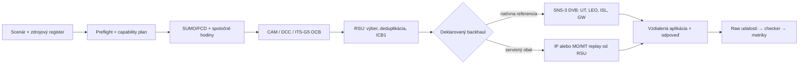

# Audit a pracovný plán zjednoteného simulátora BP

**Dátum:** 26.–27. 10. 2026. **Stav:** U0–U8 hotové v uvedenom otestovanom rozsahu; ďalšia experimentálna kampaň a podmienené rozšírenia závisia od rozhodnutí s vedúcim. **Koreň projektu:** `obnova/Bakalarska praca/`. **Runtime:** výlučne `vendor/ns-3.38-ocb-eval` (ns-3.38/SNS-3 3.38). Tento dokument nadväzuje na [historický pracovný plán](pracovny-plan-simulatora.md) a [V0–V8](plan-univerzalny-verny-simulator-2026-10-26.md); ich úspešné čiastkové brány nemení na dôkaz hotového zjednoteného systému. Pôvodné výsledky a checkery sa zachovávajú.

**Individuálne pozemné rádio áut 17. 11. 2026:** Karta auta a technická stránka upravujú výkon, šumové číslo, zisky a výšku antény pre konkrétne auto, s návratom na spoločný profil. Oba natívne enginy používajú hodnoty na príslušnom PHY a overovače ich porovnávajú so scenárom. [Dôkaz a hranice](experiments/simulator-car-radio-2026-11-17.md). Ostatné návrhy na rozšírenie vstupov ostávajú otvorené na diskusiu s vedúcim.

**Aktualizácia 2. 11. 2026:** nová požiadavka na výlučne natívnu paketovú U9 cestu má samostatné [štyri prijímacie brány a záznam behov](experiments/u9-native-packet-migration-2026-11-02.md). Čerstvý spoločný CAM/RSU/SNS-3/odpoveď beh prešiel; zachovanie tienenia v tom istom procese zatiaľ neprešlo raw verifierom a natívny negatívny test satelitného výhľadu chýba. Migrácia editora, replaya a všetkých troch konštelácií nie je vyhlásená za dokončenú.

**Aktualizácia 4. 11. 2026:** paketový panel uchováva úplnú raw stopu, ale pri replay zobrazuje len udalosti, ktoré už nastali; [overenie časovo synchronizovaného zoznamu](experiments/simulator-paketovy-zoznam-2026-11-04.md). Ide o úpravu čítania výsledkov, bez zmeny paketového enginu.

**Aktualizácia 11. 11. 2026:** panel ručnej cesty zobrazuje a upravuje grafové uzly, všetky body tvaru, smer, limit a pruhy; posun spoločného uzla sa prenesie na napojené úseky. [Overenie editora ciest](experiments/simulator-road-inspector-2026-11-11.md) pokrýva platnosť geometrie, autá na cestách a jednosmerné trasy. Paketový engine ani runtime sa nemenili.

**Aktualizácia 11. 11. 2026 — OSM graf:** [pôvodné overenie čistenia a spájania ciest](experiments/simulator-osm-road-cleanup-2026-11-11.md) je historický pokus; jeho heuristiky sú teraz pozastavené na žiadosť používateľa. [Aktuálne overenie verného OSM importu](experiments/simulator-osm-faithful-import-2026-11-11.md) zachováva krátke spojky a identitu pôvodných uzlov bez automatického skrývania či spájania úsekov v tejto historickej fáze. Aktuálny stav odstraňuje len krátke izolované komponenty podľa nasledujúcej aktualizácie.

**Aktualizácia 11. 11. 2026 — smerové a topologické pravidlá OSM:** Import revízie 9 zachováva smerové pruhy/rýchlosti, statický prístup, relácie odbočenia cez uzol a viacnásobné vstupy cesty do výrezu. Posuvný panel pri mape ukazuje skutočné vstupy SUMO a osobitne neaplikované časové podmienky a via-way relácie. Uložený 6-autový scenár prešiel editorovou kontrolou, netconvert a krátkym štartom SUMO; [dôkaz a hranice](experiments/simulator-osm-faithful-import-2026-11-11.md).

**Aktualizácia 11. 11. 2026 — zúžený panel SUMO a izolované cesty:** Na ďalšiu požiadavku používateľa panel zobrazuje len skutočné cestné XML vstupy SUMO. Časové značky sa z importu vylúčili a krátke izolované komponenty pod 100 m sa opäť nezobrazujú ani neposielajú do SUMO; pripojené krátke spojky zostávajú. [Overenie a hranica filtra](experiments/simulator-sumo-input-panel-detached-2026-11-11.md).

**Aktualizácia 11. 11. 2026 — smerové pruhy:** Panel ručnej aj OSM cesty nastavuje počet pruhov osobitne pre každý povolený smer. Jednosmerka ponúka jednu voľbu. Ručné smerové hodnoty sa zachovajú pri obnovení OSM výrezu a do SUMO idú ako oddelené `numLanes` pre jednotlivé hrany. [Overenie smerových pruhov](experiments/simulator-directional-road-lanes-2026-11-11.md).

**Oprava zobrazenia 11. 11. 2026:** Štýl `hidden` pre opačnú voľbu pruhov má prednosť pred `display:block`; prehľad SUMO už nie je pripnutý cez editor pri rolovaní. [Meranie rozloženia](experiments/simulator-directional-road-lanes-2026-11-11.md#oprava-zobrazenia-po-spätnej-väzbe).

**Viditeľnosť cestných vstupov 11. 11. 2026:** Prehľad SUMO sa zobrazuje len pri vybranej ceste alebo kreslení cesty; pri iných objektoch sa schová. [Overenie v prehliadači](experiments/simulator-sumo-input-visibility-2026-11-11.md).

**Uzavretie cestnej časti 11. 11. 2026:** Technická stránka používa skutočné smerové limity a pruhy, ukazuje súhrn smerových hrán a pravidiel odbočenia; hlavný panel uvádza presnú rýchlosť odovzdanú do `road.edg.xml`. Ručné smerové limity prežijú opätovný OSM import a generátor áut zohľadňuje aktuálne smerové pruhy. Efektívny limit v `road.net.xml` môže `netconvert` zaokrúhliť; výslednú sieť treba pri porovnaní behov kontrolovať osobitne. [Overenie a hranice](experiments/simulator-road-inputs-closed-2026-11-11.md). Ďalší audit vstupov pokračuje autami.

**Vstupy áut 13. 11. 2026:** Panel vybraného auta má kartu vstupov SUMO a kartu komunikačných vstupov. SUMO karta ukazuje a tam, kde to spoločný beh dovoľuje, upravuje rýchlosť, polohy, smerovú trasu, spoločný model vozidla, seed a trvanie; pevný odchod 0 s a krok 0,1 s sú označené. Trasa sa pred uložením kontroluje voči cestnému grafu a OSM odbočeniam. Manuálny aj OSM export XML a krátky skutočný beh SUMO prešli; [dôkaz a hranice](experiments/simulator-car-inputs-2026-11-13.md). Audit spoločného rádia, RSU, budov a satelitov pokračuje oddelene.

**Individuálny model auta 17. 11. 2026:** Sedem parametrov vozidla možno meniť osobitne; tlačidlo Predvolené obnoví dedenie spoločného modelu. SUMO aj CAM používajú účinné hodnoty auta. [Overenie](experiments/simulator-per-car-model-2026-11-17.md).

**Zjednotenie auta 17. 11. 2026:** Panel auta na ručnej aj OSM mape oddeľuje maximálnu a počiatočnú rýchlosť a umožňuje automatickú alebo vlastnú vstupnú rýchlosť. Koniec behu je len v hlavnom ovládaní. Staršie scenáre zachovávajú pôvodný význam polí. [Overenie](experiments/simulator-car-speeds-2026-11-17.md).

**Prejazd križovatkami OSM 13. 11. 2026:** Editor a SUMO používajú výslovný zoznam všetkých povolených prechodov medzi smerovými hranami v spoločnom uzle; priame otočenie po tom istom úseku sa v trasách vylučuje. Výsledná sieť sa pred behom porovná s exportovanými spojeniami. V aktuálnom 4 km výreze sa obnovili štyri ostré legálne prechody, ktoré predtým `netconvert` odhadom vynechal; FCD potvrdilo prejazd štyroch skúšobných áut. [Dôkaz a hranica OSM topológie](experiments/simulator-osm-junction-connections-2026-11-13.md).

**Zosúladenie pracovnej ikony 13. 11. 2026:** Zdrojový filter krátkych odpojených cestných komponentov a súvisiace cestné rozhranie sa preniesli do skutočného pracovného runtime, balíka na ploche a ZIPu. Test filtra, cielené OSM testy, zhoda súborov a manifest balíka prešli; existujúci proces Python servera prevezme nové importy po ďalšom spustení ikony. [Dôkaz prenosu](experiments/simulator-sumo-input-panel-detached-2026-11-11.md#prenos-do-verzie-spúšťanej-ikonou--13-11-2026).

**Rolovanie stránky 13. 11. 2026:** Skok hlavného okna po refreshi sa potvrdil v používateľskom aj samostatnom viditeľnom Firefoxe. Predbežné úpravy scroll anchoringu, obnovy histórie, ovládania máp a programového vracania polohy nestačili; ovládanie máp je späť v pôvodnom stave a dočasné zásahy do JavaScriptu boli odstránené. Hlavný obsah má teraz jediný vlastný posuvník pod hlavičkou. Desať po sebe idúcich skúšok rolovania po načítaní prešlo bez skoku; poloha zostala stabilná po dočítaní 5 722 ciest, vnútorný panel cesty i Technické parametre sa posúvajú samostatne a pôvodné koliesko stále približuje mapu. Účinok v používateľskom okne po tejto poslednej úprave ešte treba potvrdiť. [Diagnostika a overenie](experiments/simulator-scroll-2026-11-13.md#izolácia-hlavného-posuvníka).

**Neskorý skok 13. 11. 2026:** Používateľ potvrdil návrat hore a zásah starej ochrany do mapy. JavaScriptová ochrana bola odstránená. Izolované meranie vo Firefoxe zachytilo presun fokusu na ovládací prvok ľavého panelu bez kliku a následný návrat posuvníka; prichytený panel (`sticky`) ešte v tretej nasadenej skúške zlyhal. Finálne rozloženie používa jeden prirodzený dokumentový posuvník ako Technické parametre, hlavičku navrchu a pevný ľavý panel mimo posuvnej plochy. Tri 20-sekundové skúšky s finálnym rozložením prešli, mapa má správnu šírku a jej koliesko zoomuje, Technické parametre sa otvárajú a zatvárajú. Výsledok v používateľskej karte ešte treba potvrdiť. [Dôkazy](experiments/simulator-scroll-2026-11-13.md#prirodzený-dokument-a-pevný-ľavý-panel).

**Používateľský záznam 13. 11. 2026:** Skok sa opakoval aj s pevným ľavým panelom; video zachytilo zvýraznenie fokusu na hornom odkaze Technické parametre. Hlavička je preto na širokej obrazovke tiež pevná. Pri nízkom okne má ľavý panel spoločný dokumentový posuvník namiesto vnoreného posuvníka. Izolované skúšky pri 1920 × 1080 a 1000 × 650 rolovali len nadol, účinok pri samovoľnom presune fokusu v používateľskom Firefoxe zostáva na overenie. [Záznam a meranie](experiments/simulator-scroll-2026-11-13.md#záznam-používateľského-okna-a-pevná-hlavička).

**Aktualizácia 3. 11. 2026:** aktuálny simulátor odstránil pevný 10 s nábeh. Schéma 7 začína spoločný SUMO/ns-3/SNS-3 čas pri t = 0 po kontrole všetkých vstupných závislostí. Pozemný beh, tri konštelácie, dvojdružicový prípad a používateľský 20-autový výrez majú nové raw stopy a samostatné verifikácie v [denníku spoločného štartu](experiments/simulator-ready-t0-2026-11-03.md). Historický opis U0–U9 v tomto pláne zostáva záznamom vtedajšieho stavu.

## 1. Čo presne znamená „jeden obhájiteľný simulátor“

Jeden **verzovaný scenár** určí miesto, UTC epochu, mobilitu, všetkých vysielačov a RSU, aplikáciu, rádio, politiku RSU, terminál, typ spätného spojenia, modelové predpoklady, seed/run a metriky. Jeden **orchestrátor** scenár preflightuje a spustí podporovaný režim. Jeden **kontrakt udalostí a výsledkov** sleduje každú správu cez skutočne vykonané vrstvy, vrátane neúspechu. Jedna **matica schopností** presne povie, či ide o natívny generický DVB paketový beh, servisný replay za RSU, iba geometrický kandidát, alebo nevykonateľný návrh. Jedno vysvetlenie architektúry umožní ukázať kód, raw stopu, predpoklad a výsledok tej istej správy.

**Primárna výskumná jednotka:** originálna informácia vytvorená vozidlom a oprávnený príjemca. CAM je pozemná správa; ICB1 je nový report vytvorený RSU až po dekódovaní CAM (v overenom U4 má 96 alebo 98 B podľa CAM); GRA1/I2V1 sú odpovede. Ich počty a časové okamihy sa nesmú zamieňať. Satelitný výpadok nesmie automaticky vypnúť lokálne V2V/V2I rádio. Každý podiel má pomenovaný čitateľ a menovateľ (`generated`, `offered`, `air_tx`, `rsu_decoded`, `report_created`, `remote_timely`, `return_timely`); delay sa počíta len na deklarovanej populácii a od deklarovaného začiatku. `no_candidate`, `no_beam`, `no_attach`, `no_route`, `queue_drop`, `phy_drop`, `deadline` a `unknown` sú rozdielne príčiny.

**Hranica tvrdenia:** natívny SNS-3 DVB je generický referenčný model. Starlink/Iridium/Globalstar profil je servisný model s verejne doloženými limitmi a explicitnými odhadmi, kým nebude kalibrovaný porovnateľnými meraniami. Výsledok z geometrie alebo servisného replay nesmie dostať štítok natívnej operátorskej RF/MAC simulácie.

**Požiadavka na mierku (26. 10. 2026):** Počet áut, aktívnych RSU a orbitálnych objektov je vlastnosť scenára, nie pevná množina názvov v runneri. „Ľubovoľný“ znamená konfigurovateľný počet v rámci pamäte, výpočtového času, adresných priestorov a schopností modelu; nekonečnú veľkosť nemožno garantovať. Preflight musí oznámiť konkrétny limit alebo `unsupported`, nie ticho vynechať uzly. Každý počet musí prejsť tým istým ID, per-event checkerom a výstupnou schémou. Maticu 1/2 RSU × 3/12/24 áut považovať za dôkaz konkrétnych veľkostí, nie za splnenie tejto požiadavky. Satelitný počet zahŕňa aj konfiguráciu ISL grafu, beam/attach a obojsmerné routovanie, nie iba vytvorenie ďalších orbitálnych uzlov. [Presný kontrakt a súčasné limity](decisions/variable-topology-contract-2026-10-26.md).

## 2. Metóda auditu a skutočný stav

Prečítané boli [obnova](experiments/obnova-native-2026-10-25.md), zadanie, plány, rozhodnutia a denníky V0–V8; prešli sme scenár, Python runnery/checkery, aktívne C++ modely, editor, release a dostupné vstupy. Test `.venv/bin/python -m unittest discover -s tools -p 'test_*.py'` 26. 10. 2026: **86 testov, OK**. To je regresia existujúcich komponentov, nie integračný dôkaz nižšie navrhnutého systému. V tomto audite nevznikol nový natívny simulovaný beh. Súborový inventár ani úspešný test nenahrádza fyzikálnu validáciu.

| Schopnosť | Dnešný dôkaz | Dnešná hranica |
| --- | --- | --- |
| V8 CLI + natívna cesta | `tools/bp_v8.py`, `tools/run_scenario_v3_native.py`, `src/v3-native-cam-leo.cc`; end-to-end CAM→RSU→generické DVB→návrat, raw checker a offline smoke | Jediný vybraný vysielač/aktívny RSU, pevná dvojica LEO/UTC a jednoduchá periodická CAM ponuka. |
| V5 hustá pozemná prevádzka | `src/v5-ground-cam-dcc.cc`, `tools/run_v5_ground.py`; súbežní vysielači, CBR, výskumné DCC, PHY dôvody | Končí v pozemnom OCB; nevytvára ICB1 pre tú istú satelitnú simuláciu. |
| V3/V4 LEO/handover/fyzika | `src/v3-leo-single-ut.cc`, `src/v4-leo-reference.cc`; samostatné natívne dôkazy a negatívne kontroly | Nie sú vo V8 `run`; vlastné vstupy, výstupy a pevné predpoklady. |
| V6 operátorské služby | `tools/run_v6_services.py`; rozlíšené IP a MO/MT hranice | Replay z historických presne šiestich ICB1, nie z čerstvého všeobecného behu. |
| V7 metriky | `tools/analyze_v7_results.py`, `tools/bp_v8.py`; per-event dôkazy a opatrné intervaly | Dve rozdielne analytické cesty viazané na konkrétne historické rodiny. |
| Editor | `viewer/draft-editor.js`, `tools/scenario_server.py`; kreslený v2 návrh a staršie piloty, V8 preflight cesty k JSON | Kreslený návrh v2 nie je vstup natívneho V8 scenára; V8 nemožno v editore uložiť, spustiť a vyhodnotiť ako jednu cestu. |

### Register všetkých zistených dokončiteľných medzier

**Kritická** znamená prekážku jedného fungujúceho simulátora. **Vysoká** znamená medzeru v modulárnosti alebo interpretácii výsledkov. **Podmienená** závisí od výskumnej otázky, ktorá sa má vybrať s vedúcim; podmienka je explicitná, preto sa úloha nestratí.

| ID | Zistenie a dôkaz v projekte | Čo treba dokončiť; brána |
| --- | --- | --- |
| G01 kritická | `tools/scenario_v3.py` má iba `editable_v2` + syntetický dopyt; `tools/run_scenario_v3_native.py:supported` natvrdo obmedzuje DVB dvojicu 43253/43258, proxy GW, 17 dBi, 1 Gbit/s, UTC 22. 10. 12–14 h, CAM 5–55 s a ≤8 opakovaní. | Rozšíriť **jeden** kanonický kontrakt s verzovanými adaptérmi a capability preflightom. Aspoň 3 odlišné podporované scenáre sa spustia bez editácie zdroja; nepodporovaný vstup má presný dôvod. |
| G02 kritická | V8 `src/v3-native-cam-leo.cc` vyžaduje `BACKGROUND_CAM_TX == 0`; V5 `src/v5-ground-cam-dcc.cc` vysiela zo všetkých vozidiel, no nemá ICB1/GRA1/SNS-3. | Spojiť V5 časovanie, reálne OCB súťaženie, RSU dekódovanie a natívny backhaul **v jednom ns-3 čase a behu**. Pozemná záťaž musí meniť skutočne pozorovaný vstup RSU, nie len dodatočne násobiť V8 PDR. |
| G03 kritická | `src/v3-native-cam-leo.cc:event_id(gdt)` a `tools/check_scenario_v3_native.py:event_id` používajú iba CAM `generationDeltaTime`; `source_by_gdt` predpokladá unikátny čas. | Zaviesť identitu `(scenario, run, station_id, generation_epoch/sequence)` s mapou na wire formát, parent CAM ID a samostatným report ID. Dva vysielače v rovnakom čase musia mať rôzne ID; duplicita a wrap sú kontrolované. |
| G04 kritická | V8 volí jeden zdroj a jeden aktívny RSU (`tools/prepare_scenario_v3_cam.py`, `config/v8_catalog.json`); druhé RSU len počúva. | Konfigurovateľný počet aktívnych RSU, výber podľa prijatia/politiky, deduplikácia, prípadne prepnutie RSU a väzba RSU→UT. Raw stopa ukáže, ktorý RSU vytvoril či nevytvoril report a prečo. |
| G05 vysoká | V8 CAM sú rovnomerné `count × interval`; V5 má dynamický CAM/DCC a 100 ms vzorky, ale samostatnú schému `config/v5-ground-experiment.json`. | Zjednotiť generovanie FCD, časový raster, CAM trigger a DCC politiku; sprístupniť zvolené/pevné časovanie ako jasné módy. Zaznamenať generovanie, odklad DCC, pokus MAC a príjem; overiť proti izolovanému V5. |
| G06 vysoká | V5 `tools/run_v5_ground.py` pozná `measured_trips` a `surveyed_boxes`, no experimentálne vstupy `data/inputs/v5-ground/` sú syntetické; rádiové parametre nie sú kalibrované. | Vstupné adaptéry pre sledovateľné merané trasy/budovy, kontrolu jednotiek, projekcie, interpolácie a pokrytia; ak dáta chýbajú, nechať viditeľný syntetický štítok. Doplniť citlivostné rozsahy a nezávislý rádio benchmark. |
| G07 kritická | V3 `src/v3-leo-single-ut.cc` má paketový handover jedného UT, `tools/run_v3_leo_native.py` používa vlastný runner s `car0`, seed 314159 a krátkym oknom; V8 má pevné dva satelity. | Preniesť stavový automat candidate→beam→attach→route→handover do aktívneho enginu bez zmeny identity UT; podpora aspoň dvoch UTC/miest a alternatívnych párov, negatívne no-beam/no-attach/no-route. |
| G08 vysoká | V4 `src/v4-leo-reference.cc` má RF/fronty/citlivosť, no `tools/run_v4_leo_reference.py` pri kompilácii dočasne mení globálny `v3.SOURCE`. | Zdieľaný build/runner a parametrický backhaul komponent; žiadna mutácia importovaného globálneho stavu. V jednej ceste sa sprístupní výkon, zisk, šum, MODCOD/scheduler len kde je podporený, ISL kapacita/fronta, prenosová záťaž a packet drop. Analytická kontrola link budgetu a serializácie. |
| G09 vysoká | V6 `config/v6_service_contract.json` odkazuje na historický `results/p4_certus_native_20261026/positive/trace.csv`; `tools/run_v6_services.py` vyžaduje presne šesť reportov. | Režim služby prevezme čerstvé overené RSU ICB1 z rovnakého scenára s ľubovoľným podporovaným počtom. Udrží samostatné Starlink/Iridium IP a Globalstar MO/MT limity, smerovosť, queue/retry a platný štítok `service_boundary_replay`; servisná dostupnosť ostáva explicitný vstup. |
| G10 vysoká | V7 je viazaná na P5/V6, V8 analýza sumarizuje iba `offered_cam`, `rsu_created`, `remote_timely`, `return_received` a mean; p95/p99 sú potlačené. | Jeden per-event výsledkový kontrakt pre oba backhauly aj pozemný režim, s pôvodným ID, pokusom, príjemcom, časmi vrstiev, drop dôvodom, vernosťou, zdrojovým riadkom/hashom a metrickými menovateľmi. Metrika z oboch režimov sa vypočíta rovnakým analyzátorom. |
| G11 vysoká | Aktuálne negatívne kontroly sú po vetvách; chýba integračný dôkaz súbežného pozemného toku, RSU politiky, handoveru a backhaul výpadku. | Checker musí preukázať byte/čas/event kontinuitu vrátane duplicitného príjmu, izolovaných príčin strát a pokračovania V2V pri satelitnom výpadku. Mutácie raw dát aj po prepočte hashov musia zlyhať. |
| G12 vysoká | V8 `verify-analysis` vie regenerovať produkt; V7 neistota stojí na šiestich seed klastroch v dvoch epochách vzdialených 92 s; externá validácia je `null`. | Plán experimentu s nezávislými dňami/epochami, seedmi a párovanými vetvami; explicitný deadline a výber populácie pred behom. Výsledky oddelia modelovú variabilitu, citlivosť parametrov a externú neistotu; intervaly len pri dostatočných nezávislých jednotkách. |
| G13 vysoká | `viewer/draft-editor.js` má `network_execution:'schema_only'`; tlačidlo LEO spúšťa starší pilot, `/api/v8-preflight` iba overí uložený v3 súbor. | Jedna cesta `upraviť → uložiť/normalizovať → preflight → spustiť → overiť → výsledok` pre presne podporovanú podmnožinu. UI ukáže vrstvu vykonania, obmedzenie, menovateľ a raw odkaz; neponúkne C-V2X alebo operátorský RF beh ako realizovaný. |
| G14 vysoká | `scripts/v8_release.py` balí široké zdroje, no `scripts/v8_smoke.sh` a `release/README-V8.md` prijímajú úzku V8 paketovú cestu; staré výsledky sú správne mimo archívu. | Nové vydanie z čistého rozbalenia postaví a smoke overí **každý deklarovaný podporovaný režim** vrátane V5→RSU→DVB, dynamického LEO a servisného replay; zverejní pin, patch, manifest a čitateľný postup. |
| G15 vysoká | `docs/decisions/stav-vernosti.md` v historickej tabuľke stále hovorí, že handover jedného UT nie je implementovaný, zatiaľ čo V3 denník ho vykonal. Návody vedú cez viac pilotov. | Aktuálny stav, schopnosti a limity viesť z jednej autoritatívnej tabuľky s dátumom a označiť staré dokumenty ako historické. Vytvoriť jednu mapu modulov, sekvenčný walkthrough správy a vysvetlenie každého predpokladu a checkeru. |
| G16 vysoká | Orbitálna geometria v `tools/v3_leo_topology.py` je oddelená od reálneho attach/route; niektoré archívne prvky boli získané po modelovanej epoche a natívna cesta má limit vstupného TLE. | Predbežná kontrola platnosti epochy, zdroja a veku OMM/GP, 6-ciferných ID, masky a súradníc; konzistentný výstup `unsupported` pri nekompatibilnom SNS-3 vstupe. Retrospektívny dátový pôvod sa uvedie pri výsledku. |
| G17 vysoká | V8 používa jeden RSU/UT a jednoduchú ponuku; V4 fronty ukazujú kapacitné straty, ale chýba konfigurovateľný mix súbežných aplikácií z viacerých RSU. | Konfigurovateľné smerové toky, rádiová i backhaul záťaž so skutočnými paketmi a ID, queue disciplína a limit. Zmerať latenciu pre jednu správu aj pri preťažení; control-plane a user-plane oddeliť. |
| G18 vysoká | Aktuálne runnery sú samostatné programy s rozdielnymi CLI, manifestmi a preflightmi; niektoré používajú pevné cesty a implicitné predpoklady. | Jedno verejné CLI/API, typovaný normalizovaný plán, verziované adaptéry, deterministické semeno pre SUMO/ns-3/replay, izolované buildy a výstupné mená, idempotentný read-only checker. Žiadne tiché prepnutie režimu ani prepis starého behu. |
| G19 podmienená | V5 používa výskumný DCC interval, nie úplný ETSI prístupový algoritmus; CAM implementuje vybranú podmnožinu. | Ak výsledok tvrdí normovú zhodu, doplniť presnú verziu ETSI CAM/DCC mechanizmov a konformačné prípady. Inak v každom výstupe označiť `research_cam_dcc_subset` a presne opísať pravidlá. |
| G20 podmienená | Zadanie hodnotí správanie VANET pri satelitnej komunikácii; dnešná mobilita zo SUMO tečie jednosmerne a report nemá riadiaci účinok. | Ak sa má tvrdiť účinok na bezpečnosť/plynulosť, vytvoriť udalosť výstrahy/rozhodnutia, TraCI spätnú väzbu, kontrolné scenáre a dopravné metriky. Ak výskumnou otázkou zostáva sieťový výkon, tento modul mimo rozsahu a žiadny záver o nehodách či plynulosti. |
| G21 podmienená | Vykonaná aplikácia je CAM→ICB1; DENM a C-V2X/PC5 nie sú súčasťou overenej natívnej cesty, hoci širší editor technológie menuje. | DENM len pre skutočne zvolenú udalostnú úlohu s vlastným wire/checker kontraktom. C-V2X len s oddeleným modelom a porovnávacím dôkazom; dovtedy explicitne nepodporované v capability matici. |
| G22 podmienená | Autentizácia ITS správ, PKI, rušenie, kybernetické útoky, priame satelitné terminály v autách a mobilný UT nie sú aktuálnou podporovanou architektúrou RSU+UT. | Implementovať iba ak sa stanú súčasťou výskumnej otázky; inak ich presne vymenovať ako hranicu modelu. Žiadne skryté tvrdenia o bezpečnosti komunikácie alebo pokrytí priamych terminálov. |
| G23 vysoká | Dnešné P/V vetvy majú vlastné párované kontroly, no nový univerzálny kontrakt nemá záväzne definovanú rovnakú cestnú udalosť pre čisté lokálne V2X, pozemný backhaul a satelitný variant. | Zafixovať referenčné porovnanie s rovnakou mobilitou, aplikáciou, RSU a endpointom; meniť iba deklarovaný backhaul/radio faktor. Reportovať absolútne časy od originálu aj prírastok každej vrstvy. |
| G24 vysoká | Podporované rozsahy sú dnes rôzne (napr. V5 do 50 rádiových uzlov, V8 do 100 CAM/8 opakovaní) a ich runtime/pamäťová hranica nie je spoločným tvrdením. | Capability tabuľka uvedie tvrdé a otestované limity počtu uzlov, správ, simulovaného času, orbitálnych objektov a veľkosti stôp. Reprezentatívny väčší beh prejde bez ID kolízie, skracovania logu alebo neriadenej spotreby zdrojov. |

## 3. Čo sa nedá „dopísať kódom“ bez ďalších dôkazov

Tieto položky nie sú dôvodom zastaviť zjednocovanie. V parametroch zostanú ako predpoklad **D**, interval citlivosti alebo `unknown`, kým existuje porovnateľný dôkaz: skutočné beam/attach/route a brány operátora v čase a mieste; proprietárne RF/MAC, scheduler, retransmisie a reálna záťaž; konkrétny terminál, anténa, plán, profil prevádzky a SLA; nameraná mestská hustota, stavebné tienenie a V2X rádio; nezávislé raw merania rovnakej udalosti, endpointu, UTC, miesta a SKU. Geometrický kandidát nie je dostupnosť služby a produktové maximum nie je dosiahnutá rýchlosť. Register [reálnych parametrov](decisions/resers-realne-parametre-a-medzery-2026-10-26.md) a [V7 meracia brána](decisions/v7-result-and-measurement-contract.md) sú podklad pre tieto štítky.

**Rozhodnutia s vedúcim:** primárna aplikácia a deadline; či hodnotiť len sieťový výkon alebo aj účinok na dopravu; ktoré typy terminálu/služby a ktoré porovnateľné scenáre patria do finálnej matice. Základná integrácia U0–U6 sa môže realizovať nezávisle od týchto rozhodnutí; experimentálna kampaň a podmienené G19–G22 až po ich zapísaní.

## 4. Pevné poradie realizácie

Etapu uzavrieť až po celom **vertikálnom reze**: scenár → preflight → vykonanie → raw stopa → nezávislý checker → negatívna/mutačná kontrola → výsledok → krátke vysvetlenie v denníku. Rozpracovaný rez sa nesmie vykazovať ako dokončený. Každá etapa nechá historické P/V behy reprodukovateľné, no nový systém nemusí kopírovať ich internú štruktúru.

| Etapa | Práca a konkrétny výstup | Prijatie |
| --- | --- | --- |
| **U0 – kontrakt a kostra — HOTOVO 26. 10. 2026** | Zafixovaný baseline; normalizovaný scenár, capability registry, ID a jednotný event/metric schema. Oddelené `ground`, `native_generic_dvb`, `service_boundary_replay` a `geometry_only`. [Architektúra](decisions/u0-unified-architecture-contract.md), [raw/plánový dôkaz a testy](experiments/u0-unified-contract-2026-10-26.md). | Štyri znovu overené plány; validátor odmieta nepodporované kombinácie a tiché polia; kolízia súbežných CAM ID je kontrolovaná. Toto je iba preflight kontrakt, nový packet engine je U1. |
| **U1 – prvý skutočný zjednotený beh — HOTOVO 26. 10. 2026** | V5 viacvysielačový CAM/DCC/OCB a RSU→ICB1→pevný DVB→GRA1/I2V1 v jednom ns-3 procese. [Kontrakt enginu](decisions/u1-integrated-engine-contract.md), [prijímací raw dôkaz](experiments/u1-integrated-cam-leo-2026-10-26.md). | 3/24 áut, DCC on/off, positive/blocked/no_isl; lokálne počty v kontrolách presne ako V5, kladná DCC vetva pravdivo zachytáva spätné I2V zaťaženie. Identita, PCAP, LAN, ISL a odpoveď do správneho auta overené; päť mutácií odmietnutých. Obmedzenie: jeden aktívny RSU/pevný UT, syntetické vstupy a generický DVB. |
| **U2 – viac RSU a skutočná ponuka — HOTOVO V OTESTOVANOM ROZSAHU 27. 10. 2026** | Pôvodná [23‑vetvová matica](experiments/u2-multi-rsu-backhaul-2026-10-26.md) ostáva nemenná. Nástupnícky engine číta počet áut a aktívnych RSU zo scenára; [26‑vetvový prijímací beh](experiments/u2-variable-rsu-2026-10-26.md) beží cez jeden runner/checker bez pevných názvov `one/two` či `cars03/12/24`. | 1/2/3 RSU a 3/5/12/24 áut v siedmich prípadoch, párovaný local/ground/generic-DVB, tri RSU skutočne vybrané, FIFO a päť porúch; raw checker a šesť mutácií PASS. Súčasný V5 limit 50 rádiových účastníkov a najviac 20 RSU v world schéme je deklarovaný, nie skrytý. Jeden spoločný pevný UT a presne dva satelity ostávajú hranicou U2; variabilný satelitný pool patrí do U3. |
| **U3 – dynamická generická LEO cesta a variabilný satelitný pool — HOTOVO 27. 10. 2026** | Nástupnícky engine, scenárový orbitálny/ISL pool, modelový preflight, jeden UT s paketovým prepnutím a [úplný prijímací dôkaz](experiments/u3-dynamic-leo-2026-10-27.md). | Deväťprípadový natívny beh pre 1/2/3 satelity, dve UTC epochy, 35 CAM na prípad, obojsmerná trasa pred/po; samostatný úspešný štvorsatelitný pool odlišuje neaktívny objekt. Štyri zamietnutia prechodu a attach rollback; checker, šesť raw mutácií a päť neplatných orbitálnych/trasových vstupov PASS. Nespojený pool alebo ISL cez Zem je `unsupported`; generický DVB a jeden fixný UT/GW ostávajú explicitné hranice. |
| **U4 – parametrická fyzika a kapacity — HOTOVO V OTESTOVANOM ROZSAHU 27. 10. 2026** | V4 RF a skutočné smerové ISL fronty pripojené k U1–U3 packet enginu cez jeden U4 build a [šesťprípadový prijímací dôkaz](experiments/u4-parametric-integrated-2026-10-27.md). Parametre aj ich generický pôvod sú explicitné v JSON a manifeste. | Natívna ICB1/GRA1 stopa, analytické `d/c + L·8/R`, RF FSPL a zmeny Rx výkonu; dopredný drop 23 ICB1 z 24 vyslaných, spätný drop 24 GRA1 z 24 prijatých gateway; checker a päť významových + štyri vstupné mutácie PASS. 17 dBi/1 Gbit/s sú deklarovaná diagnostická referencia, nie operátorská kalibrácia. Jeden UT/GW a stromovo smerovateľné ISL zostávajú hranicou. |
| **U5 – pravdivý servisný režim — HOTOVO V OTESTOVANOM ROZSAHU 27. 10. 2026** | [Servisný adaptér a prijímací dôkaz](experiments/u5-service-bridge-2026-10-27.md) číta čerstvo overených 35 RSU reportov z U4, bez historického limitu šiestich správ. Výber 1/4/35 zachová originálne CAM/ICB1 ID, bajty, RSU, časy a raw riadky; Iridium/Starlink sú IP/UDP, Globalstar MO/MT bez IP/ISL. | 51 vetiev cez jeden runner/checker; service unavailable, UL fronta a stratovosť, miestne MO retry, oddelený MT výpadok a potvrdenie RSU. Manifest má zdroj každého času a parametra; šesť významových a štyri vstupné mutácie PASS, U4/V6 regresia PASS. Ide o servisný replay s neznámou dostupnosťou/kalibráciou, nie operátorský RF/MAC ani návrat do auta. |
| **U6 – spoločné výsledky a vedecký protokol — HOTOVO V OTESTOVANOM ROZSAHU 27. 10. 2026** | [Spoločný analyzátor a dôkaz](experiments/u6-paired-results-2026-10-27.md) párujú U2 local/ground, U4 natívny DVB a U5 servisný replay cez rovnakú CAM a RSU. 960 udalostí, 59 vetiev, explicitný 60 s deadline a rozdielne návratové endpointy. | Raw riadky a bajty, menovatele aj priemery jednotlivých úsekov sú znovu kontrolované; sedem sémantických mutácií, pôvod analyzéra a deadline 1 µs zamietajú/fungujú podľa kontraktu. Jedna spoločná pozemná realizácia: interval, p95/p99, kalibrácia a externá validácia sú `null`; citlivosť nie je odhad reality. |
| **U7 – jedno ovládanie a vysvetlenie — HOTOVO V OTESTOVANOM ROZSAHU 27. 10. 2026** | [Spoločný scenár, CLI a editor](experiments/u7-unified-control-2026-10-27.md) vykonávajú preflight, uloženie, beh, overenie, analýzu a zobrazenie raw stopy. | Overené local/ground, U3 s jedným satelitom a servisom, U4 s tromi RSU; plán a výsledky CLI/API sa zhodujú. Platí limit 50 rádiových uzlov a ďalšie uvedené obmedzenia; stará kreslená mapa sa neimportuje automaticky. |
| **U8 – čisté odovzdanie a finálne hranice — HOTOVO V OTESTOVANOM ROZSAHU 27. 10. 2026** | [Offline vydanie a prijímací dôkaz](experiments/u8-release-2026-10-27.md), [register a obhajoba](u8-obhajoba-a-registre.md), čistý zdrojový build a šesť nových behov všetkých U7 režimov bez siete. | Ubuntu 24.04 Base v izolovanom kontajneri so zdieľaným jadrom; verifikácia a mutácie PASS, lokálne a natívne záťažové prípady 24 áut/3 RSU. Limit 50 uzlov nie je celý výkonovo overený; kalibrácia a podmienené G19–G22 zostávajú podľa registra a rozhodnutia s vedúcim. |

**Poradie je závislostné:** U0→U1→U2→U3→U4→U5→U6→U7→U8. Po každej etape sa sem doplní dátum, vstupy, presný raw výstup, checker, negatívny výsledok a známe limity. Ak integrácia ukáže, že vnútorné SNS-3 API neumožňuje danú kombináciu, urobiť malý reprodukovateľný dôkaz, capability označiť `unsupported` a nahradiť rozsah pravdivým variantom; nepoužiť geometrický alebo replay výsledok ako natívny paketový výsledok.

## 5. Minimálna finálna matica a materiál na internú obhajobu

Pred väčšou vedeckou kampaňou musí malá matica prejsť aspoň: riedka/hustá súbežná CAM záťaž; DCC on/off; LOS/NLOS a explicitné tiene/budova; 1/2 aktívne RSU; pozitívny, lokálne rádio bez satelitu, no-beam, no-attach, no-ISL, queue overload a nefunkčný návrat; handover pred/pending/po; natívne DVB a každý podporovaný servisný obal. Minimálne dve nezávisle odôvodnené UTC epochy a viac seedov majú byť odlišné experimentálne jednotky. Presné čísla semien, dní, počtov a deadline sa pred finálnou maticou zmrazia v experimentálnom protokole.

Obhajobový balík obsahuje: (1) jednu mapu modulov a časovú os správy, (2) slovník CAM/ICB1/GRA1/I2V1, vrstiev a menovateľov, (3) tabuľku všetkých nastaviteľných parametrov s jednotkou, rozsahom, zdrojom a miestom použitia v kóde, (4) ukážku pozitívnej a poruchovej raw stopy s checkerom, (5) rozdiel medzi generickým DVB, servisným replay a reálnou službou, (6) reprodukčný príkaz a hash vydania, (7) jednu stránku všetkých neznámych operátorských a meracích dát. Toto je súčasť definície „hotovo“, nie dodatočné písanie až po simuláciách.

## Nadväzujúci U9: politika po jednotlivých uzloch, 30. 10. 2026

[Prijímací záznam individuálnej komunikácie](experiments/u9-per-node-policy-2026-10-30.md) dokladá dva úplné natívne behy a zachovanie historických výsledkov. Rozsah a výslovné obmedzenia sú v zázname; nejde o zmenu stavov U0–U8 ani o tvrdenie, že staršie technické profily podporujú politiku po uzloch.

## Nadväzujúci U9: glóbus a výber miesta, 30. 10. 2026

[Orbitálny náhľad a kontrola](experiments/u9-globe-2026-10-30.md) pridávajú otočnú Zem, časový náhľad celého vekovo platného archívu, geografickú kotvu scenára a povinný nový výber podgrafu po jej zmene. Ide o geometrický a ovládací celok; experimentálne metriky paketov sa tým nemenia.

## Nadväzujúci U9: reálna mapa a výrez

[Prijímací záznam mapového celku](experiments/u9-zem-a-realna-mapa-2026-10-30.md) dokumentuje súvislý glóbus s detailom ulíc, dva oddelené editovacie režimy, automatický výber cesty pri vložení auta, samostatne zapínateľné vrstvy a trvalú WGS84 evidenciu všetkých áut/RSU naprieč lokalitami. Do behu sa premieta len aktuálny 2 × 2 km výrez; skúšobný dvojlokalitný scenár prešiel preflightom s 2 z globálnych 4 áut a 2 zo 4 RSU, SUMO obsahovalo iba aktívne autá. Plná cestná sieť s pôvodnými dopravnými pravidlami, reprodukovateľným OSM snapshotom a budovy s účinkom na rádio zostávajú samostatnou ďalšou bránou; mapový podklad sa s fyzikálnym modelom nesmie zamieňať.

**Aktualizácia 31. 10. 2026:** Globálna evidencia naprieč lokalitami bola na novú požiadavku používateľa vyradená z pracovného postupu. Nové kliknutie na miesto v reálnej mape začne nový 2 × 2 km výrez, načíta jeho jazdné úseky nanovo a vyprázdni rozpracované autá a RSU. Starší odsek zostáva historickým záznamom skúšky z 30. 10.; aktuálny stav a úplný paketový beh opisuje [nový prijímací záznam](experiments/u9-cestne-objekty-a-novy-vyrez-2026-10-31.md).

## Nadväzujúci U9: automatický cestný graf a trasy, 30. 10. 2026

[Prijímací záznam úplného cestného výrezu a plánovania trás](experiments/u9-cestny-graf-trasy-2026-10-30.md) nahrádza predchádzajúce preberanie jediného úseku pri kliknutí. Celá dostupná jazdná sieť výrezu je importovaná s OSM identitou a provenienciou; autá majú náhodnú alebo kliknutím plánovanú viacúsekovú trasu. Bratislavský graf 2 040 aktívnych úsekov prešiel preflightom, SUMO aj úplným U9 `combined_advanced` behom s checkerom. Pôvodné dopravné pravidlá odbočenia, semafory, empirický dopyt a rádiový účinok budov zostávajú otvorené hranice.

**Doplnková kontrola 31. 10. 2026:** Opakované generovanie náhodnej trasy pôvodne vracalo rovnakú trasu a mohlo meniť smer, ktorý si používateľ zvolil. Oprava, päť odlišných trás na reálnom grafe, zachovanie smeru a odchodovej polohy, živé klikacie overenie a SUMO 2/2 bez kolízie či teleportu sú zaznamenané v tom istom [prijímacom zázname](experiments/u9-cestny-graf-trasy-2026-10-30.md).

**Súvislý pás a kliknutý cieľ 31. 10. 2026:** [Prijímací záznam](experiments/u9-trasa-jeden-pas-a-kliknuty-ciel-2026-10-31.md) overuje jednu geometriu trasy od auta po presný cieľ, miesto výstupu `arrivalPos` v SUMO, preflight aj izolovaný dopravný beh. Cestný graf a jeho známe hranice sa nemenia.

**Skúšobné scenáre a referenčné vrstvy 31. 10. 2026:** [Šesť predlôh, ich úplné U9 behy, verejný register RSU a viditeľnosť konštelácií](experiments/u9-skusobne-scenare-rsu-globus-2026-10-31.md). Ide o pracovné scény pre prípravu experimentov s vedúcim; nepredstavujú zvolenú finálnu maticu ani kalibráciu na reálnu službu.

**Oprava glóbusu 31. 10. 2026:** Po spätnej väzbe bol odstránený samostatný canvas satelitov a opravená aktualizácia dát po asynchrónnom načítaní konštelácie. MapLibre teraz vykresľuje subsatelitné body v tej istej projekcii ako Zem; vizuálne overené obidva mapové režimy, Iridium, Globalstar, celý Starlink, posun, zoom, prepnutie vrstvy a pohybový náhľad. Dôkaz a hranice tvrdenia sú v [prijímacom zázname](experiments/u9-skusobne-scenare-rsu-globus-2026-10-31.md).

**Doplnenie po používateľských snímkach:** Kruhový pohľad na oblohu bol presunutý pod glóbus, takže v úzkom paneli nevzniká dojem druhej odsunutej konštelácie. Tlačidlo „Celá Zem“ používa mierku, pri ktorej sa planéta zmestí do panelu. Nové otvorenie U9 stránky načítava verziovaný CSS a mapový modul; všeobecné pravidlo pre všetky `canvas` sa zúžilo na záložný glóbus. Čistá karta ukazuje satelity už pred prehrávaním a ich body ostávajú pri posune zarovnané. Starú už otvorenú kartu treba obnoviť, pretože jej bežiaci JavaScript zostáva v pamäti prehliadača.

**Oprava načítania 31. 10. 2026:** [Prijímací záznam načítania konštelácií](experiments/u9-nacitanie-konstelacii-2026-10-31.md) zachytáva automatický orbitálny náhľad po zmene profilu a vložení RSU, explicitný stav načítania/chyby a odstránenie opakovaného prepočtu 10 627 bodov pri každom prekreslení. Overené v čistom prehliadači v prázdnom i reálnom režime bez spustenia replay; nejde o nový paketový experiment.

**Doplnenie po hlásení o koliesku:** Tá istá kontrola rozlišuje geometrické zobrazenie celej konštelácie od aktívneho satelitného komunikačného profilu. Glóbus umožňuje vybrať a spustiť Iridium, Globalstar a Starlink aj pri V2V bez RSU; zakázané paketové voľby už nemajú zavádzajúci kurzor načítavania. Rýchle prepnutie konštelácií bolo overené proti oneskorenej odpovedi.

**Replay, UTC a polohy 1. 11. 2026:** [Prijímací záznam synchronizácie a auditu](experiments/u9-replay-synchronizacia-a-audit-2026-11-01.md) dokladá časovo spoločný pohyb áut a satelitov, nastaviteľný UTC začiatok priamo pri glóbuse, 10 s orbitálnu ukážku od experimentálneho času 0, klikateľné spojnice len z pozorovaných prenosov, kontrolu súbežnej priamej vetvy a opravu SUMO nástupnej polohy na reálnych cestách. Zachované zostávajú výslovné limity: budovy zatiaľ netienia rádio, dopravné vstupy nie sú empiricky kalibrované a generické DVB nie je operátorský modem.

**Rozšírenie 31. 10. 2026 — skupinové ciele a syntetická doprava:** [Implementácia a prijímací záznam](experiments/u9-skupiny-a-nahodna-doprava-2026-10-31.md). Skupina áut dostáva na spoločnej ceste oddelené cieľové polohy po 12 m; neúplne prejazdný plán sa neaplikuje. Generátor dávok váži hlavné ťahy a vytvára odbočky i rýchlosti podľa limitov ciest. Overené SUMO bez kolízií/teleportov, skupinový aj 24-vozidlový úplný U9 beh checkerom PASS. Dopyt je syntetický a zostáva otvorená kalibrácia na skutočné intenzity.

**Dĺžka trás podľa času 31. 10. 2026:** Ten istý [prijímací záznam](experiments/u9-skupiny-a-nahodna-doprava-2026-10-31.md#dĺžka-náhodných-trás-podľa-trvania-simulácie) zachytáva voliteľný cieľ 20–100 % dostupného času, generovanie nových áut aj opätovné plánovanie jednotlivých či skupinových trás. Dva SUMO behy s 30/120 s a úplný 20-vozidlový ns-3.38 beh prešli kontrolou; skutočný čas jazdy ostáva závislý od SUMO a dĺžky siete.

**Jednotný model editora a automatická konštelácia 31. 10. 2026:** [Prijímací záznam](experiments/u9-jednotny-model-2026-10-31.md) dokumentuje odstránenie úvodných predlôh a technických profilov z editora, individuálnu politiku každého auta/RSU, automatický satelitný podgraf a nové natívne testy Iridium/Globalstar/Starlink. Výslovne odlišuje geometrickú viditeľnosť, výber uzlov nesúcich pakety a skutočné doručenie. Priamy satelitný terminál auta bez akejkoľvek satelitnej RSU zostáva pre tento spoločný engine nepodporovaný.

**Oprava výberu pri zmene dĺžky a 30 s replay 1. 11. 2026:** [Prijímací záznam](experiments/u9-vyber-satelitov-farby-replay-2026-11-01.md) dokladá prevzatie zadaného času pred behom, opätovný výber orbitálneho podgrafu pre celý interval, farebné rozlíšenie skutočných paketových spojení a úplný 30 s natívny beh s časovou osou replay do 30 s.

**Výskum vernosti služieb 1. 11. 2026:** [Primárnymi zdrojmi podložený audit Iridium, Globalstar a Starlink](vyskum-vernosti-iridium-globalstar-starlink-2026-11-01.md) oddeľuje dnešný generický U9 engine od overených vlastností konkrétnych terminálov a sietí. Identifikuje opravu Globalstar bent-pipe bez ISL, produktové RF/anténne profily, časovo meniaci sa výber, šesťmiestne katalógové ID a meraciu hranicu. Etapy R1–R5 v audite sú **návrh ďalšej práce**, nie vykonaná implementácia ani zmena stavov U0–U9.

**Spresnenie priority podľa používateľa 1. 11. 2026:** Najbližším cieľom je najvernejšie fyzikálne pokrytie jednotlivých služieb — dráhy, generačne viazané lúče a ich možné smerovanie, zorné pole terminálu, link budget, budovy a terén. [Audit definuje vetvu F1–F4](vyskum-vernosti-iridium-globalstar-starlink-2026-11-01.md#najvernejší-dosiahnuteľný-model-fyzikálneho-pokrytia). Presné sieťové smerovanie, zaťaženie a obchodná dostupnosť sa majú riešiť neskôr. Výstup fyzikálnej vetvy musí rozlišovať horizont, anténne možnú oblasť a miesto s kladným link budgetom; okamžitý aktívny beam bez telemetrie nesmie byť tvrdený ako fakt.

**Prvý implementovaný celok fyzikálnej vetvy 1. 11. 2026:** [Produktové geometrické obálky všetkých troch konštelácií](experiments/u9-fyzikalne-obalky-2026-11-01.md) sú v editore, automatickom výbere a náhľade. Serving/handover výber rešpektuje doložené terminálové a elevačné hranice; FSPL je len diagnostika. Táto brána je hotová v uvedenom rozsahu. F1 generačná identifikácia Starlinku a čerstvejšie efemeridy, F2 skutočné lúčové kontúry, F3 link budget a tienenie, F4 validácia proti terénnemu meraniu zostávajú otvorené. U9 packet engine zatiaľ nezískal vernosť konkrétnej komerčnej služby.

**Nový záväzný postup 1. 11. 2026:** [Plán fyzikálnej vernosti F1a–F6](plan-fyzikalna-vernost-2026-11-01.md) rozdeľuje orbitálne vstupy, pripnutie scenára, šesťmiestne ID, časový výber, antény, prekážky, link budget a validáciu na samostatné prijímacie celky. [F1a: čerstvý priamy archív CelesTrak a integrity gate](experiments/f1a-cerstve-orbitalne-vstupy-2026-11-01.md) je hotový; F1b pripnutie nového snapshotu k úplnému U9 behu je ďalší krok. Týmto sa nemenia historické stavy U0–U9.

**Doplnenie pozemného tienenia 1. 11. 2026:** [Prijímací záznam](experiments/u9-pozemne-tienenie-budov-2026-11-01.md) spája presné OSM pôdorysy a scenárový odhad výšky s pozemným ITS-G5 kanálom v spoločnom U9 behu. Tienenie platí pre V2V, V2I a I2V; párovaná kontrola aj reálny výrez s 4 722 budovami prešli. Ide o geometricky podmienený mestský rádiový model bez meranej miestnej RF kalibrácie. Historická poznámka pri replay, že budovy netienia rádio, opisuje stav pred touto úpravou.

**Pracovný editor a paketový rozklad 1. 11. 2026:** [Prijímací záznam](experiments/u9-obdlznik-budovy-pakety-2026-11-01.md) dokladá nastaviteľný obdĺžnikový výrez, ručné budovy v prázdnom svete, presnejší výber cieľa a významový rozklad CAM pomocou pripnutej Vanetza ASN.1 knižnice. Úplný obdĺžnikový beh, historické overenia a 49 regresných testov prešli. ASN.1 UPER má bitové hranice, preto zvýraznenie ukazuje spoločný bajtový rozsah; neznáme bajty sa nehádajú.

**Oprava úvodného glóbusu 1. 11. 2026:** [Prijímací záznam načítania konštelácií](experiments/u9-nacitanie-konstelacii-2026-10-31.md#oprava-inicializácie-po-prepnutí-mapy--1-11-2026) dokladá odstránenie prázdneho orbitálneho náhľadu po štarte a prepnutí mapy. Pri zachovaných mapových návrhoch sa obnoví ich vlastný výber konštelácie; lokálna UI kontrola prešla pre Iridium, Globalstar a Starlink.

**Obnova cestných dát pri limite OSM 1. 11. 2026:** [Záznam cache a automatického opakovania](experiments/u9-cestne-objekty-a-novy-vyrez-2026-10-31.md#obnova-po-limite-osm-api--1-11-2026) dokladá zachovanie stiahnutých dlaždíc mimo balíka a spätný čas ďalšieho pokusu. Malý živý výrez a limitovaná odpoveď prešli; 4 km výrez ostáva závislý od kapacity externého OSM API.

**Lokálne Slovensko 2. 11. 2026:** [Prijímací záznam](experiments/u9-lokalny-osm-slovensko-2026-11-02.md) dokladá pripnutý PBF Slovenska, overenú integritu, výber iba celých vnútroštátnych výrezov a pôvodný API fallback mimo nich. HTTP import 2 km aj 4 km výrezu Bratislavy načítal cesty a budovy z lokálneho PBF bez kvóty OSM API; dátum zdroja a SHA-256 sú v scenárovom pôvode. Vyššie uvedená závislosť 4 km od externého API platí teraz iba mimo lokálne pokryté Slovensko.

**Zjednotenie názvov a prenosného balíka 10. 11. 2026:** Aktívne CLI, server, Python moduly, C++ enginy, testy, konfigurácie a študijné kotvy majú opisné názvy; historické experimenty a výsledky zostali zachované. Dvojdňový učebný materiál je aktualizovaný a vložený aj do ZIPu. [Prijímací záznam](experiments/readable-simulator-2026-11-10.md) obsahuje mapu premenovania, 38 testov, výsledky pozemného, satelitného a D1 behu, verifikáciu surových stôp, rozbalenia ZIPu a spustenia z nového pracovného prostredia. Podporovaná čistá inštalácia prenosného balíka ostáva Ubuntu 24.04 x86_64; táto konkrétna čistá kombinácia ešte nebola v tomto prostredí vyskúšaná.

**Audit a technická správa 18. 11. 2026:** [Záznam](experiments/simulator-audit-2026-11-18.md) dokladá príčinu falošného odmietnutia dokončeného behu starým serverom, nový pozemný beh, opätovné overenie satelitného behu, grafické prehratie oboch režimov a integritu nového ZIPu. Aktuálny balík obsahuje `TECHNICKA-SPRAVA.md` namiesto staršieho dvojdňového študijného textu. Stav U0–U8 ani deklarovaný rozsah modelu sa nemení.

**Oprava tvaru glóbusu 10. 11. 2026:** [Záznam](experiments/globus-po-obnove-2026-11-10.md) opisuje inicializáciu MapLibre s rozmermi aj počas načítania, následné prispôsobenie plátna a verziované súbory proti starej cache. Zdrojový editor, aktuálny pracovný adresár, prenosný ZIP aj stále otvorené staršie okno dostali opravu. Lokálny prehliadač ukázal kruhovú Zem po obnovení aj po prepnutí režimu; testy a integrita balíka prešli.

**Mazanie poslednej cesty 10. 11. 2026:** [Záznam](experiments/mazanie-poslednej-cesty-2026-11-10.md) dokladá odstránenie poslednej nepoužitej cesty, ochranu trasy auta, možnosť odstrániť aj posledné auto a odstránenie nepoužívaných cestných uzlov. Editorová kontrola, 38 testov, pracovný balík a ZIP prešli.

**Kreslenie cesty: šípky späť/dopredu 10. 11. 2026:** [Záznam](experiments/kreslenie-cesty-krok-spat-dopredu-2026-11-10.md) dokladá vracanie jednotlivých bodov rozpracovanej cesty, vymazanie histórie dopredu po novom bode a kontrolu zdroja, pracovnej verzie aj rozbaleného ZIPu. Hotový segment sa naďalej zapisuje až po dokončení cesty.

**Vstupné parametre budov, RSU a technických vrstiev 17. 11. 2026:** [Prijímací záznam](experiments/simulator-input-control-2026-11-17.md) opisuje editor pôdorysu a výšok budov, individuálne pozemné rádio RSU s dedičstvom spoločného profilu, presný CSV vstup konkrétneho ns-3 uzla a rozdelenie technickej stránky na SUMO, ns-3, aplikáciu a SNS-3. Pozemný a integrovaný satelitný beh s dvoma RSU a odlišnými profilmi majú raw stopy a nezávislý checker. Pevné protokolové a architektonické hranice sú uvedené osobitne; táto úprava neznamená kalibráciu na reálnu operátorskú sieť.
