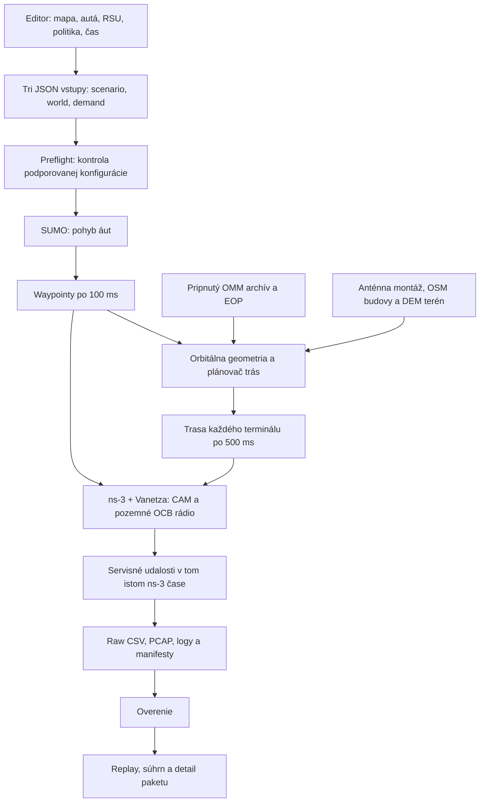

# Ako funguje náš simulátor — zrozumiteľný technický prehľad

**Stav prečítaného pracovného kódu: 1. november 2026.** Prvá časť reportu. Druhá časť, `02-technicky-rozbor-kodu.md`, vysvetľuje konkrétne funkcie, dátové štruktúry, rovnice a súbory. Tento text opisuje implementáciu, nie plán budúceho simulátora.

## 1. Čo sme vlastne vytvorili

Vytvorili sme výskumný simulátor dopravy a komunikácie. V jednom scenári máme autá na cestách, prijímače pri cestách, satelity, satelitné terminály a modelovú vzdialenú bránu. Sledujeme, ako vznikne správa v aute, kto ju prijme po miestnom rádiu, či ju terminál dokáže preniesť cez modelovú satelitnú cestu a či sa vráti odpoveď alebo výstraha.

Nie je to jeden program, ktorý robí všetko od začiatku. Je to integrácia viacerých odborných nástrojov a nášho vlastného kódu. SUMO rieši pohyb áut. ns-3 rieši sieťové udalosti a pozemné rádio. Vanetza vytvára a spracúva dopravné správy CAM. Python pripravuje vstupy, vypočítava satelitné trasy, spúšťa programy a kontroluje výsledky. Webový editor umožňuje scenár zostaviť a výsledok prezrieť.

**Najdôležitejšie rozlíšenie:** pozemný prenos má model rádiového kanála a paketové protokoly. V aktuálnej hlavnej satelitnej vetve modelujeme časovú cestu a prenos bajtov pomocou udalostí. Nepoužívame v nej presný modem komerčného operátora. Model vie povedať „podľa našich vstupov existovala prípustná cesta a tento paket po nej model doručil“. Samotný výsledok ešte neznamená „na tomto mieste funguje reálny Starlink“.

## 2. Celky a ich úlohy

| Celok | Bežným jazykom | Čo dodáva ďalšiemu celku |
| --- | --- | --- |
| Webový editor U9 | Pracovný stôl, na ktorom poskladáš pokus | Mapu, autá, trasy, RSU, nastavenia komunikácie a čas |
| Lokálny Python server | Sprostredkovateľ medzi prehliadačom a programami | Validované vstupy, spustený proces, výsledky a replay |
| SUMO | Dopravný simulátor | Polohu, rýchlosť a smer každého auta po 0,1 s |
| Prevodník pohybu | Prekladateľ medzi SUMO a sieťovým modelom | Tabuľku waypointov v jednotkách potrebných pre rádio a CAM |
| Vanetza | Implementácia časti dopravného komunikačného zásobníka | Skutočné CAM bajty, BTP a GeoNetworking |
| ns-3.38 | Simulačný čas a model siete | Vyslanie, súbeh, príjem alebo stratu pozemného rámca |
| Orbitálny výpočet | Výpočet polohy satelitov pre zvolený UTC čas | Polohy, elevácie, vzdialenosti a možné spojenia |
| Prostredie a antény | Filter možných smerov spojenia | Kandidátov po zohľadnení masky, montáže, terénu a budov |
| Servisný plánovač | Výber modelovej cesty pre každý terminál | Tabuľku satelitných trás po 0,5 s |
| Servisný paketový model | Časový model odoslania a doručenia správy | Surovú stopu ponúk, prenosov, odpovedí a dropov |
| Checkery a manifesty | Účtovníctvo a kontrola pokusu | Overenie vstupov, pôvodu bajtov a súladu výsledkov |
| Mapa a glóbus | Zobrazenie návrhu alebo overeného behu | Zrozumiteľný pohľad na to, čo sa stalo |

Jediným aktívnym sieťovým runtime je ns-3.38 v `vendor/ns-3.38-ocb-eval`. Obsahuje aj SNS-3 3.38, ktoré používajú staršie generické DVB experimenty. ns-3.48 už v aktívnom projekte nie je.

## 3. Celá cesta jedného pokusu

Diagram opisuje aktuálnu satelitnú vetvu `unified` s `dynamic_physical=true`. Čistý pozemný pokus satelitnú časť preskočí. Staršie uložené režimy sa spúšťajú vlastnými vetvami.

Dôležitý detail: SUMO sa vykoná vopred. ns-3 potom číta pripravený pohyb. Nie je tu živá spätná väzba, v ktorej by prijatá výstraha okamžite prikázala SUMO autu zabrzdiť alebo zmeniť trasu. Doprava ovplyvňuje komunikáciu, ale komunikačný výsledok dnes automaticky nemení dopravu.

## 4. Ako vznikne svet a pohyb

Máme tri odlišné druhy vstupov:

- **World:** cesty, RSU, geografické ukotvenie a dĺžka pokusu.
- **Demand:** konkrétne autá, ich trasy, odjazdy a zadané rýchlosti. „Demand“ znamená dopravný dopyt: kto chce po cestách jazdiť.
- **Scenario:** komunikačné nastavenia, seed, UTC, satelitná skupina, zdroj sledovanej správy a politika zariadení.

Pri reálnej mape z OSM berieme cestnú geometriu. To ešte neznamená, že máme reálne nameranú dopravnú intenzitu. Autá vytvorené v editore sú syntetická premávka na reálnych cestách. To je užitočný pokus, ale treba ho tak pomenovať.

SUMO vytvorí FCD, teda časový záznam pohybu. Každých 100 ms odčítame polohu, rýchlosť a smer. Prevodník priradí aj zemepisnú polohu, identitu stanice a čas CAM. Ak auto v požadovanom čase vo FCD chýba, príprava má zlyhať. Krátke trasy dokáže príprava doplniť skutočným SUMO zastavením tak, aby auto zostalo rádiovým účastníkom do konca okna. Také auto potom stojí; neznamená to, že stále jazdí pôvodnou rýchlosťou.

Poloha v ns-3 sa aktualizuje po vzorkách. Plynulý pohyb ikony na obrazovke môže byť vizualizačná interpolácia. Nie je to dodatočné fyzikálne meranie medzi vzorkami.

## 5. Čo vysiela auto

Auto vytvára CAM, Cooperative Awareness Message: správu o svojom stave. Obsahuje identitu stanice, čas, zemepisnú polohu, rýchlosť a smer. Vanetza ju zakóduje do binárneho ASN.1 UPER formátu. To sú skutočné bajty správy, nie iba údaj „auto poslalo paket“.

Každá 100 ms vzorka je príležitosť posúdiť vyslanie, nie automaticky nový paket. Prvá CAM vznikne hneď. Ďalšie závisia od pohybu a časovania: posun nad 4 m, zmena rýchlosti nad 0,5 m/s, zmena smeru nad 4° alebo periodické pravidlo. Preto desať vzoriek za sekundu nemusí znamenať desať CAM za sekundu.

Pozemná CAM sa zabalí do BTP-B a GeoNetworking single-hop broadcast. ns-3 ju vysiela cez model IEEE 802.11p OCB, teda rádiovú komunikáciu vozidiel bez bežného pripájania ku klasickému Wi-Fi prístupovému bodu. Používame 5,9 GHz, kanál široký 10 MHz a nastavený OFDM režim 6 Mb/s.

Všetky autá nemusia mať rovnaké možnosti. Politika pri aute umožňuje komunikáciu s autami aj RSU, iba s autami alebo vypnutú pozemnú komunikáciu. Priamy satelitný terminál je samostatná voľba. „Iba autá“ je v kóde aj filter spracovania na RSU; nie je to zázračné rádio, ktorého vlny sa k RSU vôbec nedostanú.

## 6. Čo sa deje pri pozemnom prenose

Vyslanie ešte neznamená príjem. Záleží na vzdialenosti, zvolenom modeli útlmu, vysielacom výkone, šume, súbehu vysielaní a správaní MAC/PHY vrstvy. Prijímač musí rámec skutočne dekódovať a Vanetza musí získať platnú CAM.

Verejný U9 scenár dnes prijíma `friis` alebo `urban_los`. Friis je základný model šírenia vo voľnom priestore. `urban_los` používa mestský model s vynútenou priamou viditeľnosťou. V nižšom kóde existujú aj NLOS, budovy a shadowing, ale dostupnosť v C++ neznamená, že ich používateľ môže zapnúť ľubovoľným poľom v U9 JSON.

**Budovy na satelitný výhľad a budovy v pozemnom rádiovom modeli sú dve odlišné veci.** Aktuálne importované OSM budovy vstupujú do lokálneho satelitného LOS testu. Samotná prítomnosť budov na mape neprepína verejný pozemný `urban_los` na úplný model tieneného mesta.

CBR je podiel času, keď stanica v poslednom približne sekundovom okne zaznamenala obsadený kanál. Kód vie podľa CBR obmedzovať tempo CAM výskumným DCC pravidlom. Aktuálna U9 príprava však DCC nastavuje na vypnuté. Súbor `dcc_decisions.csv` aj tak zaznamenáva rozhodovanie o CAM.

## 7. Dve cesty do satelitnej časti

**Cez RSU:** auto odvysiela CAM, RSU ju skutočne prijme a povolená RSU ponúkne servisnému modelu report. Nový backend vytvára ponuku z každej povolenej prijímajúcej RSU. Keď jednu CAM prijmú tri také RSU, môžu vzniknúť tri reporty.

**Priamo z auta:** pri vytvorení CAM ju vybrané auto ponúkne aj svojmu modelovému satelitnému terminálu. Táto vetva nepotrebuje predchádzajúci príjem na RSU. Auto môže mať priame satelitné vysielanie aj pri vypnutom pozemnom vysielaní. Verejný satelitný U9 preflight napriek tomu stále vyžaduje aspoň jednu vhodnú RSU a pozemne aktívny referenčný zdroj. To je súčasná hranica vstupného kontraktu.

Nová obálka `C1` obsahuje identitu stanice, čas CAM a presné CAM bajty. Starší DVB engine používal odlišný reťazec `ICB1 → GRA1 → I2V1`. Tieto dve implementácie sa nemajú pri vysvetľovaní miešať.

## 8. Odkiaľ poznáme polohy satelitov

Používame uložený orbitálny archív OMM. Je to vstup s parametrami dráh, nie online potvrdenie služby. Scenár si pripne adresár archívu a SHA-256 jeho manifestu. SHA-256 je kontrolný odtlačok: zmena vstupných bajtov sa má prejaviť zmenou odtlačku.

Zo vstupov počítame polohy propagátorom SGP4. Astropy pomáha s časom a prevodom súradnicových rámcov; EOP údaje opisujú orientáciu Zeme. Zo vzájomnej polohy terminálu a satelitu dostaneme eleváciu a vzdialenosť. Elevácia je uhol nad miestnym horizontom.

Nový servisný plánovač pracuje s vekovo platným poolom skupiny Starlink, Iridium NEXT alebo Globalstar. Veľkosť archívu neznamená počet aktuálne používaných satelitov. Nad mestom môže byť veľa geometrických kandidátov, ale konkrétny terminál používa jednu vybranú trasu.

Katalógové ID identifikuje verejný orbitálny objekt. Aktuálny kód vie aj šesťmiestne ID. Historická päťmiestna hranica SNS-3 sa rieši adaptérom interného aliasu; verejná identita sa má zachovať.

## 9. Kedy je satelit kandidátom

Postupne kontrolujeme viac otázok:

1. Je nad potrebnou výškovou maskou?
2. Dovoľuje tento smer použitá fyzikálna obálka terminálu?
3. Ak je zadaná montáž Starlink panelu, zmestí sa smer do jeho zorného poľa?
4. Nezacláňa lokálny terén alebo budova?
5. Existuje pre túto službu prípustná modelová cesta k proxy bráne?
6. Prejde paket časovaním a veľkostnými pravidlami modelu?

Každá otázka je silnejšia než samotné „vidím bod na glóbuse“. Ani všetky dnešné kladné odpovede však nenahrádzajú kompletný rádiový link budget a potvrdenie aktívnej služby.

Pre Starlink máme v modeli produktové zorné pole 140°, teda 70° od osi panelu, a verejnú obálku s dolnou eleváciou 25°. Uplatnenie je hranicou konkrétneho modelu terminálu a verejných podkladov, nie dôkazom generácie či stavu každého satelitu. Iridiu a Globalstaru nevymýšľame úzky smerový cutoff tam, kde nemáme kvantifikovaný inštalovaný anténny diagram.

Budovy z OSM majú pôdorys a výšku alebo interval výšok. Chýbajúce výšky sa v aktuálnom kóde odhadujú aj z miestnych podobných budov; ostávajú označené ako odhad. Terén sa berie z hashovaných HGT dlaždíc do lokálneho 30 m rastra. Výhľad môže byť `clear`, `blocked` alebo `uncertain`. Neistý kandidát je v predvolenom intervalovom variante optimisticky ponechaný a označený, nie prehlásený za zaručený.

## 10. Čím sa odlišujú tri služby v modeli

| Model služby | Prípustná cesta | Časovanie a hranice |
| --- | --- | --- |
| Iridium NEXT / Certus 9770 | Jeden satelit priamo k proxy bráne alebo dva s jedným geometricky možným ISL | Predvolene 22 kb/s nahor a 88 kb/s nadol ako produktové maximá; skutočná susednosť a prístup sú neznáme |
| Globalstar RM200M | Ten istý satelit musí vidieť terminál aj proxy bránu; bez ISL | MO 9–144 B, MT 9–128 B, half-duplex; 2,4 kb/s je výskumný predpoklad |
| Starlink FHP | Predvolene jeden satelit s cestou k proxy bráne; voliteľne jeden optický proxy ISL | 1 Mb/s v oboch smeroch je výskumný predpoklad; anténna obálka nie je model celého modemu |

Tabuľka opisuje hodnoty uložené v našom zdrojovom kóde, nie čerstvé nezávislé meranie produktov. Detaily pôvodu sú v projektových záznamoch F2c/F3.

**Proxy brána** znamená modelový pozemný bod. Nemáme potvrdené, že konkrétny operátor práve tam, v danom čase a pre náš terminál poskytuje použitelný gateway.

Výber trasy sa opakuje po 0,5 s pre každý terminál. Ak je stará cesta stále platná, prechod na lepší satelit brzdí hysterézia 3° a minimálny pobyt 2 s. Znižuje to zbytočné prepínanie. Je to náš plánovací algoritmus.

## 11. Ako sa paket prenesie a čo znamená odpoveď

Servisný model vezme skutočné bajty, vyberie časovo platnú trasu, zohľadní obsadenie terminálu a vypočíta čas doručenia. Zahŕňa serializáciu správy zadanou rýchlosťou, modelový relay čas, propagáciu podľa vzdialeností a nastavené prístupové oneskorenie. Predvolený prístupový čas je nula: optimistická dolná hranica.

Ak trasa neexistuje, správa je priveľká, prenos by skončil za experimentom alebo sa počas letu zmení trasa, model zapíše drop s konkrétnym dôvodom. Nie je tu kompletný model komerčných retransmisií a pridelenia rádiových zdrojov.

Po prijatí na bráne sa vytvorí `K1` odpoveď. Pri RSU reporte ide späť na terminál RSU. **Počítadlo odpovedí terminálu teda samo osebe nehovorí, že pôvodné auto prijalo odpoveď cez ITS-G5.** Pri priamom termináli auta končí modelová odpoveď na tomto aute.

Samostatný mechanizmus výstrahy vytvorí jednu `A1` správu z vhodnej správy sledovaného zdroja. Tá ide k inej cieľovej RSU a RSU ju naozaj odvysiela cez OCB. Až `CAR_ALERT_OCB_RX` znamená zaznamenaný príjem tejto výstrahy v aute. Výstraha je synteticky spustená aplikácia; zatiaľ to nie je detektor nehody, zápchy ani úplná DENM implementácia.

## 12. Čas: prečo raw stopa začína pri desiatich sekundách

Máme nábeh 10 s a potom používateľské okno pokusu. Pri 6 s experimente sa hlavné raw udalosti nachádzajú od ns-3 času 10 s do 16 s. V prehrávači sa nábeh odčíta, takže vidíš 0–6 s.

UTC vo `scenario.utc_origin` je pôvod interného času. Používateľské t = 0 preto zodpovedá UTC origin + 10 s. Je to podstatné pri porovnaní polôh satelitov s paketmi. Používateľské UTC políčko v editore predstavuje začiatok zobrazeného pokusu; pri ukladaní sa tento rozdiel prevádza na interný pôvod. Aktuálny nový draft tento posun zohľadňuje pri predvolenom UTC.

Spoločný čas znamená, že CAM, pozemný príjem, servisná ponuka, odpoveď a výstraha v servisnom C++ behu používajú ten istý plánovač udalostí ns-3. Neznamená to, že SUMO beží súbežne cez živé riadenie.

## 13. Čo robí staršia SNS-3 vetva

Staršie režimy `native_generic_dvb`, `combined_full` a `combined_advanced` majú samostatnú hodnotu. SNS-3 v nich skutočne simuluje generické DVB user/feeder PHY/MAC a projekt modeluje IP/UDP, ISL linky, fronty, terminály, sondy handoveru a odpovede.

Výhodou je podrobnejší generický paketový a rádiový satelitný zásobník. Hranicou je, že generický DVB model nie je presná rádiová architektúra všetkých troch služieb. Staršie malé feederové stromy navyše nie sú univerzálnou dynamickou konšteláciou. Preto nový hlavný servisný backend túto vrstvu nepoužíva ako skrytú ďalšiu cestu.

Podrobnosť modelu a vernosť konkrétnej službe sú dve osi. Detailný generický DVB model môže mať viac PHY detailov, ale nový jednoduchší servisný model vie napríklad správne zakázať ISL pri Globalstare. Ani jedna cesta bez kalibrácie neoprávňuje tvrdiť reálnu dostupnosť operátora.

## 14. Ako vieme, že výsledok nie je iba pekná animácia

Beh ukladá vstupy, zdrojové odtlačky, surové CSV stopy, rádiové PCAP a logy. Verifikátor znovu skontroluje odtlačky, prepočíta trasy a porovná servisné ponuky s pôvodnými CAM TX/RX bajtmi. Kontroluje časové okno, povolenú architektúru a súlad počítadiel so stopou.

Replay sa vytvára až z overeného behu. Pri veľkom výsledku prenesie do prehliadača obmedzený počet udalostí a polôh. Detail paketu číta príslušnú raw stopu. Počet čiar v animácii preto nemusí byť počet všetkých prenesených paketov.

`PASS` znamená, že výsledok prešiel konkrétnymi implementovanými kontrolami. Nie je to matematický dôkaz bezchybnosti celého programu ani validácia reálnej komerčnej siete.

## 15. Čo vieme obhájiteľne skúmať

Vieme skúmať vplyv syntetickej dopravy, rozmiestnenia RSU, politík terminálov, pozemného výkonu a šumu, UTC a pripnutých dráh, lokálneho výhľadu, orientácie panelu, modelovej rýchlosti a servisnej architektúry. Vieme nájsť konkrétny paket a vysvetliť jeho pôvod, cestu a dôvod nedoručenia.

Dnes z toho automaticky nevyplýva poradie operátorov podľa spoľahlivosti, skutočný goodput, p99 latencia služby ani počet odvrátených nehôd. Chýba overený kompletný obojsmerný RF model so známymi modemovými prahmi, komerčný beam/attach/scheduler, prevádzkové meranie a spätná reakcia vodiča. V pracovnom kóde už pribudol samostatný link-budget overlay: vypočíta voľnopriestorový útlm, Doppler a pri dodaných predpokladoch interval rádiovej rezervy. V prečítanom stave však tento výstup sám neblokuje servisné pakety; podrobnosti sú v druhej časti, kapitole 11. Počasie a vegetácia majú v aktuálnej vrstve samostatný dátový kontrakt; ich samotné uvedenie v JSON ešte nepridáva vypočítaný dB útlm do servisného doručenia.

Ak to potrebuješ povedať vlastnými slovami na konzultácii: **„SUMO nám vytvorí pohyb áut. V ns-3 s Vanetzou vysielame a dekódujeme skutočné CAM správy cez ITS-G5. Pripnuté orbitálne dáta, montáž antén a lokálne prekážky určujú modelové satelitné trasy. Servisný backend prenáša tie isté bajty v spoločnom čase a zaznamenáva príjmy aj odmietnutia. Výsledky kontrolujeme zo surových stôp. Ide o výskumný model možností a predpokladov, zatiaľ bez úplnej kalibrácie komerčných služieb.“**

## 16. Slovník na ďalšie čítanie

| Pojem | Význam v našom projekte |
| --- | --- |
| VANET | Sieť komunikujúcich vozidiel a cestnej infraštruktúry |
| V2V / V2I / I2V | Auto–auto / auto–infraštruktúra / infraštruktúra–auto |
| RSU | Pevná komunikačná stanica pri ceste |
| UT | Satelitný používateľský terminál; môže patriť RSU alebo autu |
| Backhaul | Prenos z miestnej RSU smerom k vzdialenej sieti/aplikácii |
| LEO / ISL | Nízka obežná dráha / spoj medzi satelitmi |
| PHY / MAC | Model rádiového prenosu / pravidlá prístupu ku kanálu |
| CAM / UPER | Správa o stave vozidla / jej binárne ASN.1 kódovanie |
| GN / BTP | GeoNetworking / základná transportná vrstva ITS |
| OCB | Komunikácia IEEE 802.11 mimo klasického Wi-Fi pripojenia k BSS |
| OMM / SGP4 / EOP | Orbitálne vstupy / propagátor dráh / údaje orientácie Zeme |
| WGS84 / ENU / ECEF | Zemepisný rámec / miestne východ-sever-hore / súradnice viazané na Zem |
| FCD / waypoint | Časový výstup pohybu zo SUMO / jedna pripravená vzorka polohy |
| Seed / run | Nastavenie reprodukovateľnej náhodnosti ns-3 |
| PCAP / raw trace | Záznam paketových rámcov / surový záznam udalostí |
| Manifest / checker | Evidencia odtlačkov a výsledku / program, ktorý kontroluje deklarované vlastnosti |

Podklady a presné odkazy na implementáciu sú v druhej časti a v sprievodnom registri `03-zdroje-a-overenie.md`.
