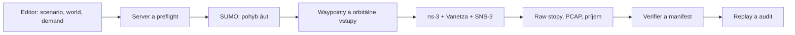

# Ako čítať kód simulátora

Tento sprievodca je k **aktívnemu vlastnému kódu** simulátora. Súbory v `vendor/` sú prevzaté knižnice ns-3, SNS-3, Vanetza a ich závislosti; nie sú naším vysvetľovaným kódom. Komentovaná verzia aktívnych súborov je v [indexe](INDEX.md). Bežné slovenské komentáre sú vložené medzi nezmenené riadky kódu. Spustiteľný zdroj a prenosný ZIP sa komentármi nemenia.

**Čítaj priamo komentované kópie, nie iba tento sprievodca.** Komentáre vysvetľujú najmä účel funkcií, vstupy, jednotky a prechody medzi SUMO, ns-3, SNS-3 a rozhraním. Niektoré pomocné orientačné komentáre sa vytvárajú automaticky; vecný výklad kritických miest je ručne napísaný v `komentare.json`.

## Jedna veta o celom systéme

Editor vytvorí scenár, Python ho skontroluje a pripraví pohyb zo SUMO, natívny program v ns-3/Vanetza/SNS-3 vykoná paketový prenos a nezávislé checkery zo surových stôp rozhodnú, čo sa naozaj stalo. Replay iba zobrazuje overené dáta.



## Čítaj v tomto poradí

1. [Používateľský editor](komentovany-zdroj/viewer/simulator.js): začni pri `S`, `currentPayload()`, `save()`, `run()` a `poll()`. `S` je stav v prehliadači. `currentPayload()` vytvorí JSON pre server. `run()` nepočíta rádiový prenos v prehliadači.
2. [Editorové API](komentovany-zdroj/tools/simulator_editor_api.py) a [server](komentovany-zdroj/tools/simulator_server.py): sleduj, kde HTTP požiadavka načíta/uloží scenár a kde vznikne samostatný simulačný job. URL stránky je len vstup do tohto servera.
3. [Schéma scenára](komentovany-zdroj/tools/simulator_sumo.py) a [hlavný runner](komentovany-zdroj/tools/simulator_cli.py): `validate()`/`preflight()` odmietajú neplatný vstup; `run()` vykoná celý beh; `verify()` ho spätne kontroluje. Tu sa rozhoduje, ktorý natívny engine sa spustí.
4. [Vstup SUMO](komentovany-zdroj/tools/simulator_ground_runner.py) a [príprava CAM](komentovany-zdroj/tools/simulator_mobility_export.py): pochop, odkiaľ sú polohy áut, ako sa čas vzorkuje a ako vznikajú waypointy. SUMO rieši pohyb; neposiela CAM ani DENM.
5. [Pozemný C++ engine](komentovany-zdroj/src/vanet-ground-network.cc): sleduj `encode_cam()`, `Station` a `main()`. Vanetza tvorí obsah CAM/DENM a GeoNetworking/BTP; ns-3 modeluje pozemné rádio a skutočný príjem.
6. [Integrovaný C++ engine](komentovany-zdroj/src/vanet-leo-network.cc): čítaj `Station::check()`, `Station::send_cam()`, `Station::emit_denm()`, socketové prijímače, fronty a `main()`. Je to najdôležitejší súbor pre cestu auta cez RSU a satelit k ďalšej RSU. Pri zdĺhavom `main()` si najprv označ bloky: načítanie argumentov, uzly, rádia, SNS-3, časovanie, stopy, `Simulator::Run()`.
7. [Satelitná fyzikálna podmienka](komentovany-zdroj/src/satellite-link-condition.h) a [pozemné budovy](komentovany-zdroj/src/ground-building-condition.h): tu sa preveruje link pri prenose. Ďalšie analytické vysvetlenie je v [pokrytí](komentovany-zdroj/tools/simulator_physical_coverage.py), [link budgete](komentovany-zdroj/tools/simulator_link_budget.py) a [orbitálnom zdroji](komentovany-zdroj/tools/simulator_orbit_source.py).
8. [Checkery CAM/DENM](komentovany-zdroj/tools/simulator_message_verifier.py), [pozemného behu](komentovany-zdroj/tools/simulator_ground_verifier.py) a [integrovaného behu](komentovany-zdroj/tools/simulator_satellite_verifier.py): pýtaj sa, aké raw stopy checker vyžaduje, aký negatívny prípad odmietne a čo presne znamená PASS.
9. [Replay](komentovany-zdroj/viewer/simulator.js), [glóbus](komentovany-zdroj/viewer/globe.js), [reálna mapa](komentovany-zdroj/viewer/earth-map.js) a [inspektor paketu](komentovany-zdroj/viewer/packet-inspector.js): sú to zobrazenia návrhu alebo uloženého výsledku. Netvoria pakety ani neprepisujú fyziku behu.
10. Až potom čítaj [plánovač trás](komentovany-zdroj/viewer/route-planner.js), [generátor dopravy](komentovany-zdroj/viewer/traffic-spawner.js), [technické parametre](komentovany-zdroj/viewer/technical-parameters-bridge.js) a [samotnú technickú stránku](komentovany-zdroj/viewer/technical-parameters.js).

## Čo sa stane s jedným CAM

1. SUMO poskytne časovanú polohu auta. Python ju prevedie na waypoint s lokálnymi metrami a WGS84.
2. `Station::update_position()` aktualizuje ns-3 MobilityModel aj polohu vo Vanetza. `Station::check()` vyhodnotí pohyb, periodický interval a obsadenosť kanála (DCC).
3. `Station::send_cam()` vytvorí normovaný obsah CAM cez Vanetza, zabalí ho do BTP/GeoNetworking a ponúkne ns-3 OCB zariadeniu.
4. ns-3 vypočíta rádiový prenos vrátane modelu kanála a prípadného tienenia. Až prijímacia callback funkcia RSU alebo auta je dôkazom príjmu. Raw bajty, dôvody PHY strát a udalosti sa zapisujú samostatne.
5. CAM ostáva v lokálnej pozemnej sieti. RSU ju neprenesie cez satelit ako DENM.

CAM je periodická správa o stave vozidla. Súčasná aplikácia ju neposiela cez satelit. DENM sa môže preniesť cez RSU do vzdialenej oblasti podľa udalosti a politík scenára.

Aktuálny scenár používa CAM v pozemnej vrstve a DENM aj v satelitnej vetve medzi RSU.

## Čo sa stane s jedným DENM

DENM vznikne z explicitnej udalosti scenára: jej polohy, času, typu, platnosti, polomeru a prípadného opakovania. Vanetza zakóduje správu do ASN.1 UPER. Pozemná vetva ju šíri cez ITS-G5. Pri vzdialenej RSU ide paket cez terminál, natívny SNS-3 používateľský kanál, satelitnú topológiu a bránu/cieľový terminál, potom späť do pozemného rádia cieľovej RSU. Každý úsek musí mať vlastný záznam odoslania a prijatia. **Scenár DENM nemení automaticky trasu auta**; jej reakcia na prijatú výstrahu je budúca samostatná funkcia, ak ju bude treba skúmať.

## Kde je fyzika a kde sú predpoklady

| Oblasť | Kde sa rozhoduje | Čo to znamená |
|---|---|---|
| Pohyb áut | SUMO a pripravené trasy | Dopravný model, nie autonómne rozhodovanie podľa prijatých správ. |
| Pozemný paket | Vanetza + ns-3 OCB | Normované CAM/DENM polia; kanál, kolízie a prijatie spracúva ns-3. |
| Budovy | OSM alebo ručný pôdorys; natívna podmienka | Tienenie podľa geometrie a deklarovanej/odhadnutej výšky. |
| Orbita | Pripnutý orbitálny katalóg a predpoveď | Poloha je časovo závislá; Orbitálne záznamy majú vlastnú epochu a presnosť. |
| Satelitný paket | SNS-3 3.38 v ns-3 3.38 | Generický DVB model; nejde o skutočný modem Starlink/Iridium/Globalstar. |
| Anténa a Doppler | Natívna podmienka terminálu | Fyzikálne testy podľa zadaného profilu; skutočné profily operátorov nie sú verejne úplné. |
| Replay a mapa | JavaScript z výsledkov | Interpolácia a kresba; neovplyvňujú úspešnosť paketu. |

Ak máš pri obhajobe vysvetliť dostupnosť satelitu, rozlišuj: **geometrický kandidát → fyzikálne prijateľný link → terminál/topológia → ponúknutý paket → skutočne prijatý paket**. Sú to rôzne tvrdenia a majú rôzne dôkazy.

## Mini slovník pri čítaní

- **WGS84**: zemepisná šírka/dĺžka; **ENU**: lokálne metre východ/sever/hore; **ECEF**: súradnice so začiatkom v strede Zeme.
- **FCD**: časové polohy vozidiel zo SUMO; **waypoint**: vzorka polohy pripravená pre ns-3 a CAM.
- **CAM**: správa o stave vozidla; **DENM**: výstraha o udalosti; **UPER**: bitové kódovanie ASN.1; **BTP/GN**: transportná a sieťová vrstva ITS.
- **OCB**: režim 802.11p bez asociácie; **PHY**: fyzická rádiová vrstva; **CBR/DCC**: obsadenosť kanála a regulácia vysielania.
- **UT/GW/ISL**: používateľský terminál, brána a medzisatelitné spojenie.
- **raw stopa/PCAP**: zachytené bajty a udalosti; **verifier**: samostatná kontrola, či z nich vyplýva tvrdený výsledok.
- **seed/ns-3 run**: riadenie náhodnosti; rovnaký scenár bez rovnakých týchto hodnôt nie je rovnaké opakovanie.

## Ako udržať vysvetlenia aktuálne

Pri zmene aktívneho súboru uprav príslušný opis a komentáre v `docs/studium-kodu/komentare.json`, potom z koreňa projektu spusti:

```bash
python3 scripts/refresh_study_code.py
python3 scripts/refresh_study_code.py --check
```

Generátor používa rovnaký zoznam aktívnych C++ a Python súborov ako prenosný balík a výslovný zoznam aktuálnych UI/štartovacích súborov. Ak nový súbor chýba v komentároch, kontrola zlyhá. Úpravy rob vždy v pôvodnom zdroji, nie v generovanej študijnej kópii. Pre vysvetlenie vedeckých hraníc použij aj [stav vernosti](../decisions/stav-vernosti.md) a [technickú špecifikáciu](../technicka-specifikacia.md).
